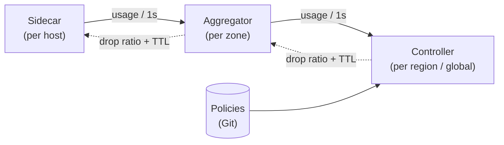

<div align="center">

# Valve

**Global rate limiting for service meshes, with no network call on the request path.**

[](https://pkg.go.dev/github.com/aupv9/valve)
[](go.mod)
[](https://goreportcard.com/report/github.com/aupv9/valve)
[](LICENSE)


[How it works](#how-it-works) ·
[Quick start](#quick-start) ·
[Policies](#policies) ·
[Docs](#documentation) ·
[Roadmap](#roadmap)

</div>

---

Valve enforces **global** quotas across hundreds of services and tens of thousands of hosts. Each sidecar decides locally, in nanoseconds, by comparing a random number with a per-bucket **drop ratio**. The control plane computes those ratios once per second from global offered load and is never on the request path.

The design follows [Uber's Global Rate Limiter (GRL)](https://www.uber.com/blog/ubers-rate-limiting-system/). There is no Redis and there are no token buckets on the hot path: the limit is enforced by a feedback loop.

## Highlights

- **Zero network calls per request.** The decision is an atomic load plus one random draw: about 18 ns/op with 0 allocations.
- **Global quotas without per-host budgets.** Drop ratios scale automatically as hosts autoscale, so quotas never need to be re-split.
- **Fail-open by design.** Every directive carries a TTL. When the control plane is lost, sidecars stop dropping and keep serving traffic.
- **Stable control loop.** EWMA smoothing, hysteresis, a slew limit and a hard clamp prevent oscillation and limit the blast radius.
- **Safe rollout.** Shadow mode is the default for new buckets, and a global kill switch is built in.
- **Policy as code.** Buckets are YAML files in Git, strictly validated in CI.

## How it works



1. **Sidecar.** It matches each request to a bucket, counts *offered* load (including dropped requests), and rejects with `429` when `rand() < drop_ratio`.
2. **Aggregator.** It sums usage from every sidecar in its zone and relays directives back down. It is stateless.
3. **Controller.** It smooths offered load per bucket and computes a drop ratio. Overload of 1.5× the limit yields a drop ratio of about 33% on every host:

   ```math
   \hat{R}_t = \alpha R_t + (1-\alpha)\hat{R}_{t-1}, \qquad p_t = \max\!\left(0,\ \frac{\hat{R}_t - L}{\hat{R}_t}\right)
   ```

Every tier speaks the same bidirectional gRPC stream, [`RateLimitControl.Sync`](api/ratelimit/v1/ratelimit.proto).

## Quick start

**Requirements:** Go 1.27+. [`buf`](https://buf.build/docs/installation) is needed only to regenerate protobuf code.

```sh
git clone https://github.com/aupv9/valve.git
cd valve
make test         # unit tests with -race
make run-local    # controller + aggregator + agent, 30k RPS against a 20k limit
```

`run-local` starts the full control loop on your machine with synthetic load. Within about 5 seconds it settles near the limit:

```text
msg="synthetic load" allowed=30000 rejected=0
msg="synthetic load" allowed=26552 rejected=3448
msg="synthetic load" allowed=21201 rejected=8799
msg="synthetic load" allowed=20104 rejected=9896
```

To see fail-open, stop the controller or the aggregator. When the 5-second directive TTL expires, the agent logs `directive TTL expired, failing open` and stops rejecting.

### Make targets

| Target | Description |
| --- | --- |
| `make test` | Run unit tests with the race detector |
| `make bench` | Benchmark the `Decide()` hot path |
| `make lint` | Run `go vet` and `buf lint` |
| `make proto` | Regenerate `gen/` from `api/` |
| `make validate` | Validate every file in `policies/` |
| `make build` | Build all binaries into `bin/` |
| `make run-local` | Run the full loop locally with synthetic load |

## Policies

A bucket declares who calls whom, the limit, its scope, and whether it is enforced or only observed:

```yaml
buckets:
  - name: checkout-from-web
    match:
      caller: web-gateway       # from mesh mTLS identity; omit = any caller
      callee: checkout          # required
      endpoint: CreateOrder     # omit = every endpoint
    limit_rps: 20000
    scope: global               # global | regional | zonal
    priority: high              # low | medium | high
    mode: shadow                # shadow (default) | enforce
```

Validate the policies before you open a merge request:

```sh
go run ./cmd/configurator validate policies/*.yaml
```

The most specific match wins, in this order: caller + endpoint, then caller, then endpoint, then callee only. Unknown fields, duplicate names and duplicate matches are rejected.

## Components

| Binary | Runs | Role |
| --- | --- | --- |
| [`agent`](cmd/agent) | One per host | Reports usage and applies drop ratios. It currently drives the in-process filter. |
| [`aggregator`](cmd/aggregator) | Several replicas per zone | Sums usage and relays directives. It is stateless. |
| [`controller`](cmd/controller) | One per region (plus global) | Computes drop ratios each cycle. |
| [`configurator`](cmd/configurator) | CI | Validates and compiles policies. |

<details>
<summary><b>Project layout</b></summary>

```text
api/ratelimit/v1/     Protobuf API, the same at every tier
gen/                  Generated Go code (committed)
cmd/                  Binaries: agent, aggregator, controller, configurator
internal/
  filter/             Hot path: match, count, drop by ratio, TTL fail-open
  controller/         Drop-ratio math (EWMA, hysteresis, slew, clamp) and control loop
  policy/             YAML schema, validation, compiled match table
  hub/                Stream server shared by aggregator and controller
  upstream/           Reconnecting stream client shared by agent and aggregator
  counter/            Sharded lock-free counter
policies/             Bucket policies
docs/                 Design, implementation status, operations
```

</details>

## Documentation

The documentation is in Vietnamese.

| Document | Contents |
| --- | --- |
| [Design](docs/design.md) | Goals, the algorithm, failure modes, multi-region setup and rollout plan |
| [Implementation](docs/implementation.md) | Design-to-code map, status per component, measured results |
| [Operations](docs/operations.md) | Build, local run, CLI flags, policy reference, tuning |

## Roadmap

Valve is **experimental**. The control loop is implemented end to end, but the mesh integration is not, so it is not production-ready.

- [x] Feedback loop: sidecar filter, aggregator, regional controller
- [x] Shadow mode, kill switch, TTL-based fail-open
- [x] Policy validation CLI
- [ ] Envoy integration: read stats and push ratios through RTDS to the fault filter
- [ ] xDS config delivery and a dedicated kill-switch channel
- [ ] Global tier for `scope: global`, leader election, bucket sharding
- [ ] Priority-tier shedding wired into the data path
- [ ] Metrics (OpenTelemetry / Prometheus) and mTLS between tiers
- [ ] Policy impact simulation against historical traffic
- [ ] Per-user and per-tenant limits through heavy-hitter sketches

## Acknowledgements

The architecture is based on [Uber's Rate Limiting System](https://www.uber.com/blog/ubers-rate-limiting-system/) from Uber Engineering.

## License

Valve is released under the [MIT License](LICENSE).
