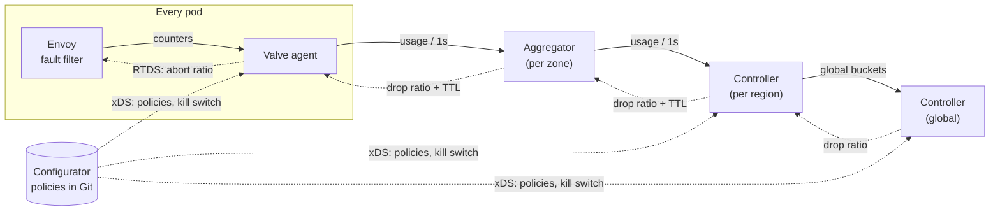

<div align="center">

# Valve

**Global rate limiting for service meshes, with no network call on the request path.**

[](https://github.com/aupv9/valve/actions/workflows/ci.yml)
[](https://pkg.go.dev/github.com/aupv9/valve)
[](go.mod)
[](https://goreportcard.com/report/github.com/aupv9/valve)
[](LICENSE)


[How it works](#how-it-works) ·
[Quick start](#quick-start) ·
[Policies](#policies) ·
[Docs](#documentation) ·
[Roadmap](#roadmap)

</div>

---

Valve enforces **global** quotas across hundreds of services and tens of thousands of hosts. Each sidecar decides locally, in nanoseconds, by comparing a random number with a per-bucket **drop ratio**. The control plane computes those ratios once per second from global offered load and is never on the request path.

The design follows [Uber's Global Rate Limiter (GRL)](https://www.uber.com/blog/ubers-rate-limiting-system/). There is no Redis and there are no token buckets on the hot path: the limit is enforced by a feedback loop.

## Highlights

- **Zero network calls per request.** The decision is an atomic load plus one random draw: about 17 ns/op with 0 allocations.
- **Works with unmodified Envoy.** Ratios reach Envoy's fault filter over RTDS, and counters come from its admin API. No custom build is needed.
- **Global, regional and zonal quotas.** A global tier sums every region. If it is lost, each region falls back to its traffic share of the limit.
- **Priority tiers.** Under overload, low-priority traffic is shed first and high-priority traffic last.
- **Fail-open by design.** Every directive carries a TTL. When the control plane is lost, sidecars stop dropping and keep serving traffic.
- **Stable control loop.** EWMA smoothing, hysteresis, a slew limit and a hard clamp prevent oscillation and limit the blast radius.
- **Safe operations.** Policies are delivered over xDS, bad updates are NACKed, shadow mode is the default, and a kill switch rides its own channel.
- **Production plumbing.** Leader election on Kubernetes Leases, hash sharding, Prometheus metrics, and mTLS with certificate hot reload.

## How it works



1. **Sidecar.** Envoy, or Valve's in-process filter, matches each request to a bucket and rejects with `429` when `rand() < drop_ratio`. Usage counts *offered* load, which includes dropped requests.
2. **Aggregator.** It sums usage from every sidecar in its zone and relays directives back down. It is stateless.
3. **Controller.** It smooths offered load per bucket and computes a drop ratio. Overload of 1.5× the limit yields a drop ratio of about 33% on every host:

   ```math
   \hat{R}_t = \alpha R_t + (1-\alpha)\hat{R}_{t-1}, \qquad p_t = \max\!\left(0,\ \frac{\hat{R}_t - L}{\hat{R}_t}\right)
   ```

Every tier speaks the same bidirectional gRPC stream, [`RateLimitControl.Sync`](api/ratelimit/v1/ratelimit.proto). The configurator serves policies and the kill switch over xDS.

## Quick start

**Requirements:** Go 1.27+ and Docker with Compose v2. [`buf`](https://buf.build/docs/installation) is needed only to regenerate protobuf code.

### With a real Envoy sidecar

```sh
git clone https://github.com/aupv9/valve.git
cd valve
make demo-up
docker compose -f deploy/demo/compose.yaml logs -f load-web load-mobile
```

The demo runs the whole control plane and an Envoy sidecar in front of a `checkout` service. `web-gateway` sends 300 RPS against an enforced 200 RPS limit; `mobile` sends 150 RPS against a 100 RPS limit in shadow mode:

```text
web      06:59:25 200=210 429=90
web      06:59:26 200=206 429=94
mobile   06:59:26 200=150
```

Flip the kill switch and every request goes through within a second:

```sh
curl -X PUT localhost:28080/kill-switch -d '{"enabled":true}'
```

Metrics are at `localhost:29102/metrics` (agent) and `localhost:29104/metrics` (controller). Stop the demo with `make demo-down`.

### Without Docker

```sh
make test         # unit tests with -race
make run-local    # controller + aggregator + in-process agent, 30k RPS against a 20k limit
```

Within about 5 seconds the agent settles near 20,000 allowed and 10,000 rejected per second. Stop the controller or the aggregator, and the agent fails open when the 5-second directive TTL expires.

### Make targets

| Target | Description |
| --- | --- |
| `make test` | Run unit tests with the race detector |
| `make bench` | Benchmark the `Decide()` hot path |
| `make lint` | Run `go vet`, `golangci-lint` and `buf lint` |
| `make proto` | Regenerate `gen/` from `api/` |
| `make validate` | Validate every file in `policies/` |
| `make build` | Build all binaries into `bin/` |
| `make run-local` | Run the full loop locally with synthetic load |
| `make demo-up` / `make demo-down` | Start or stop the Docker demo with Envoy |
| `make docker` | Build the `valve:dev` image with every binary |
| `make certs` | Generate a throwaway CA and mTLS certificates into `certs/` |

## Policies

A bucket declares who calls whom, the limit, its scope, and whether it is enforced or only observed:

```yaml
buckets:
  - name: checkout-from-web
    match:
      caller: web-gateway       # from mesh mTLS identity; omit = any caller
      callee: checkout          # required
      endpoint: CreateOrder     # omit = every endpoint
    limit_rps: 20000
    scope: global               # global | regional | zonal
    priority: high              # low | medium | high
    mode: shadow                # shadow (default) | enforce
```

Validate the policies before you open a merge request, then generate the Envoy config for a service:

```sh
go run ./cmd/configurator validate policies
go run ./cmd/configurator envoy -policy policies -service checkout
```

The most specific match wins, in this order: caller + endpoint, then caller, then endpoint, then callee only. Unknown fields, duplicate names and duplicate matches are rejected. A changed file is picked up by `configurator serve` within seconds; an invalid one is rejected and the last valid version stays live.

## Components

| Binary | Runs | Role |
| --- | --- | --- |
| [`agent`](cmd/agent) | Next to every Envoy sidecar | Pushes abort ratios to Envoy over RTDS and reads its counters. `-mode inprocess` uses Valve's own filter instead. |
| [`aggregator`](cmd/aggregator) | Several replicas per zone | Sums usage and relays directives. It is stateless. |
| [`controller`](cmd/controller) | Per region, plus a global tier | Computes drop ratios each cycle. It supports leader election and hash sharding. |
| [`configurator`](cmd/configurator) | Next to the policy repository, and in CI | Serves policies and the kill switch over xDS, validates policies, and generates Envoy config. |
| [`loadgen`](cmd/loadgen) | Demo and testing | Sends HTTP at a fixed rate and prints status codes every second. |

<details>
<summary><b>Project layout</b></summary>

```text
api/ratelimit/v1/     Protobuf API, the same at every tier
gen/                  Generated Go code (committed)
cmd/                  Binaries: agent, aggregator, controller, configurator, loadgen
internal/
  filter/             In-process hot path: match, count, drop by ratio and tier, TTL fail-open
  envoy/              Envoy integration: config generator, RTDS + admin-stats data plane
  controller/         Drop-ratio math, tiered shedding, scopes, global fallback, control loop
  policy/             YAML schema, validation, compiled match table, proto conversion
  hub/                Stream server shared by aggregator and controller
  upstream/           Reconnecting stream client and shard directive merger
  xds/                xDS server and client for policies and the kill switch
  leader/             Kubernetes Lease leader election
  metrics/, admin/    Prometheus metrics, /metrics /healthz /readyz
  tlsutil/            mTLS credentials with certificate hot reload
  counter/            Sharded lock-free counter
policies/             Bucket policies
deploy/demo/          Docker Compose demo with a real Envoy sidecar
scripts/              Development helpers (dev certificates)
docs/                 Design, implementation status, operations
```

</details>

## Documentation

The documentation is in Vietnamese.

| Document | Contents |
| --- | --- |
| [Design](docs/design.md) | Goals, the algorithm, failure modes, multi-region setup and rollout plan |
| [Implementation](docs/implementation.md) | Design-to-code map, status per component, measured results |
| [Operations](docs/operations.md) | Demo, CLI flags, Envoy integration, Kubernetes, mTLS, metrics and alerts, tuning |

## Roadmap

Valve is **experimental**. Every component of the design runs and has been tested end to end with Envoy 1.37, but it has not been load tested at production scale.

- [x] Feedback loop: sidecar filter, aggregator, regional controller
- [x] Shadow mode, TTL-based fail-open
- [x] Envoy integration: ratios through RTDS to the fault filter, counters from admin stats
- [x] xDS config delivery and a dedicated kill-switch channel
- [x] Global tier for `scope: global` with regional fallback, leader election, bucket sharding
- [x] Priority-tier shedding
- [x] Prometheus metrics and mTLS between tiers
- [ ] Go filter running inside Envoy (per-tier ratios at the sidecar, more match dimensions)
- [ ] Policy impact simulation against historical traffic
- [ ] Per-user and per-tenant limits through heavy-hitter sketches
- [ ] `Retry-After` on 429 responses

## Acknowledgements

The architecture is based on [Uber's Rate Limiting System](https://www.uber.com/blog/ubers-rate-limiting-system/) from Uber Engineering.

## License

Valve is released under the [MIT License](LICENSE).
