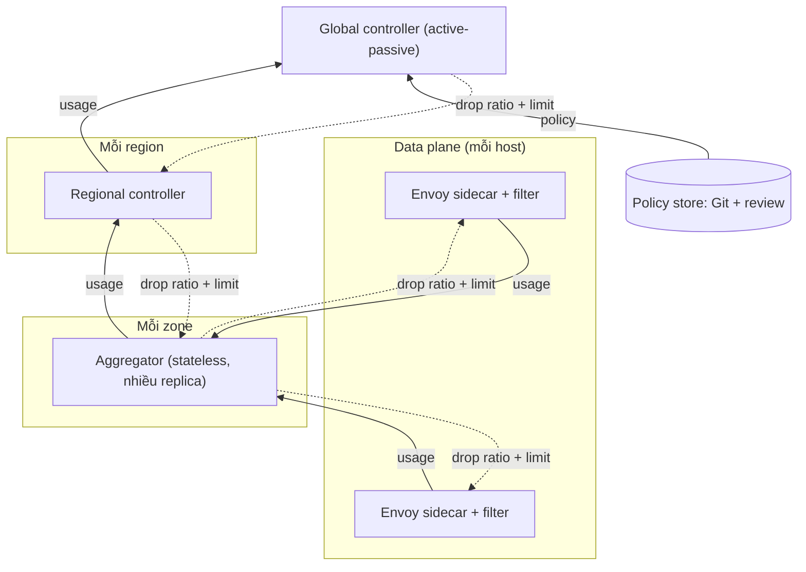

# Thiết kế Centralized Rate Limiter (kiểu Uber GRL)

> Chuyển từ tài liệu thiết kế gốc: [Thiết kế Centralized Rate Limiter (kiểu Uber GRL)](https://claude.ai/artifact/BjMti3PajUPSq3976BDMEW), bản ngày 22/10/2026. Khi hai bản lệch nhau, tài liệu gốc là nguồn sự thật cho thiết kế; tài liệu này là bản đi kèm code. Trạng thái triển khai từng phần nằm ở [implementation.md](implementation.md).

## Bối cảnh & mục tiêu

Mục tiêu là một hệ thống rate limit tập trung cho 100+ service, nhiều region, enforce tại Envoy sidecar, mà không thêm một lần gọi mạng đồng bộ vào mỗi request.

Cách làm phổ biến (mỗi service tự nhúng thư viện + Redis riêng) gây ra ba vấn đề: policy phân mảnh, không có cái nhìn toàn cục khi một client gọi nhiều service, và Redis trở thành điểm nghẽn/điểm chết trên hot path.

**Goals**

- Giới hạn theo nhiều chiều (caller, callee, endpoint, tenant, priority) với quota **toàn cục**, không chỉ theo từng host.
- Quyết định cho request tại chỗ (in-process, dưới 100 µs), không phụ thuộc đồng bộ vào control plane.
- Cấu hình động, có shadow mode và rollback trong vài giây.
- Chịu lỗi: control plane chết thì data plane vẫn chạy với trạng thái cuối cùng đã biết.

**Non-goals**

- Không đảm bảo chính xác tuyệt đối từng request; chấp nhận sai số vài phần trăm quanh ngưỡng.
- Không thay thế load shedding/autoscaling của từng service, chỉ bổ sung cho chúng.
- Không làm billing/quota thương mại (cần độ chính xác khác).

**Yêu cầu phi chức năng (giả định, cần xác nhận)**

| Chỉ số | Mục tiêu |
| --- | --- |
| Overhead mỗi request | p99 dưới 100 µs, không gọi mạng |
| Độ trễ phản ứng với spike | 1–3 giây từ lúc vượt ngưỡng đến lúc bắt đầu drop |
| Sai số quanh ngưỡng | trong khoảng ±5–10% |
| Availability data plane | 99.99%, fail-open khi mất control plane |
| Quy mô | 100+ service, hàng chục nghìn host, vài triệu RPS toàn cầu |

## Bài học từ Uber GRL

Uber bỏ Redis và token bucket trên hot path, thay bằng vòng phản hồi ba tầng: quyết định drop được đưa ra cục bộ trong proxy theo một **drop ratio** do control plane tính từ số liệu toàn cục ([Uber Engineering: Uber's Rate Limiting System](https://www.uber.com/blog/ubers-rate-limiting-system/)).

| Tầng | Vai trò |
| --- | --- |
| Rate-limit client (trong service mesh data plane) | Khớp request vào bucket theo caller/procedure, drop xác suất theo drop ratio, báo RPS mỗi host lên trên |
| Aggregator (mỗi zone) | Gom số liệu từ mọi client trong zone, gửi lên controller |
| Controller (mỗi region và toàn cục) | Cộng số liệu các zone, so với ngưỡng, đẩy drop ratio xuống aggregator và client |

Công thức cốt lõi mà bài blog nêu:

```math
\text{drop\_ratio} = \frac{\text{actual\_rps} - \text{limit\_rps}}{\text{actual\_rps}}
```

Ví dụ: caller đang ở 1,5 lần giới hạn thì mọi instance drop khoảng 33% request, nên tổng lưu lượng còn đúng bằng ngưỡng mà không host nào cần biết quota riêng của mình.

**Những điều nên học theo**

- Hot path không gọi mạng và không giữ token: chỉ so sánh một số ngẫu nhiên với drop ratio. Uber báo cáo việc bỏ hop Redis giảm rõ độ trễ đuôi (P99.5 từ vài trăm ms xuống còn vài chục ms ở một service quan trọng).
- Fail-open: mất control plane thì client không drop, đánh đổi bảo vệ lấy sự an toàn.
- Chấp nhận trễ 2–3 giây so với thời gian thực; hiếm khi ảnh hưởng độ chính xác, trừ burst cực ngắn.
- Scope global/regional/zonal, matching theo caller, procedure hoặc cả hai, hành vi deny hoặc allow (shadow mode).
- Rate Limit Configurator (RLC) đề xuất giới hạn từ lịch sử nhiều tuần (peak + buffer) và đẩy qua control plane có sẵn.

Quy mô Uber công bố: khoảng 80 triệu request/giây trên hơn 1.100 service; một service quan trọng đã chịu được tăng đột biến 15 lần (22K lên 367K RPS) mà không suy giảm.

**Hệ quả thiết kế cho chúng ta:** vì drop là theo tỷ lệ chứ không theo quota từng host, hệ thống tự cân bằng khi số host thay đổi (autoscale) mà không cần chia lại quota. Đây là lý do chính để chọn mô hình này cho 100+ service.

## Kiến trúc tổng thể

Data plane là Envoy sidecar tự quyết định drop tại chỗ; control plane chỉ gửi xuống drop ratio và cấu hình, không nằm trên đường request.



Hai luồng chạy song song mỗi giây: **usage đi lên** (sidecar → aggregator → regional → global) và **drop ratio + limit đi xuống** (global → regional → aggregator → sidecar). Policy store (Git + review) là nguồn sự thật duy nhất cho bucket và quota; global controller nạp nó và phân phối qua các tầng dưới.

## Thuật toán & đo lường

Sidecar chỉ đếm và rút thăm ngẫu nhiên; phần tính toán nặng nằm ở controller, chạy mỗi chu kỳ khoảng 1 giây.

**Trên mỗi request (sidecar)**

1. Match request vào bucket theo (caller, callee, endpoint, priority) bằng bảng đã biên dịch sẵn khi nhận config, không parse lại mỗi lần.
2. Tăng counter atomic của bucket (chia shard theo worker để tránh tranh chấp).
3. Nếu bucket đang có drop ratio p lớn hơn 0, rút u ngẫu nhiên trong [0,1); drop khi u nhỏ hơn p và trả 429 ngay tại sidecar.
4. Mỗi chu kỳ, gửi snapshot counter lên aggregator.

Counter phải đếm **offered load**, tức cả request bị drop. Nếu chỉ đếm request được cho qua, controller sẽ thấy usage giảm sau khi drop, nới ratio ra, rồi lại vượt ngưỡng: hệ thống dao động.

**Trên mỗi chu kỳ (controller)**

```math
\hat{R}_t = \alpha R_t + (1-\alpha)\hat{R}_{t-1}, \qquad p_t = \max\!\left(0,\ \frac{\hat{R}_t - L}{\hat{R}_t}\right)
```

Trong đó R là offered RPS của bucket trên toàn scope, L là limit, α là hệ số làm mịn. Thêm hai chốt chống dao động: chỉ bật drop khi R vượt L quá một biên nhỏ (hysteresis), và giới hạn mức thay đổi p giữa hai chu kỳ (slew limit).

| Tham số | Gợi ý khởi đầu | Lý do |
| --- | --- | --- |
| Chu kỳ báo cáo/tính | 1 giây | khớp độ trễ 2–3 giây mà Uber chấp nhận |
| α (EWMA) | 0,5 | phản ứng nhanh với spike nhưng lọc nhiễu |
| Hysteresis | 5% trên limit | tránh bật/tắt liên tục quanh ngưỡng |
| Slew limit | tối đa 0,2 mỗi chu kỳ | giảm dao động, vẫn đạt ratio đích trong 5 chu kỳ |

Các con số trên là giả định khởi đầu, cần tinh chỉnh bằng load test.

**Priority.** Khi phải shed S = R − L, controller phân bổ từ priority thấp nhất lên: mỗi tier có p = min(1, phần còn phải shed / R của tier), nên traffic quan trọng chỉ bị drop khi các tier thấp hơn đã bị drop hết.

**Giới hạn theo key cardinality cao (mỗi user, mỗi tenant).** Không đưa hết vào vòng phản hồi. Dùng heavy-hitter sketch (count-min + top-K) ở sidecar, chỉ báo các key vượt ngưỡng lên controller. Đây là phần mở rộng do tài liệu này đề xuất, không phải phần Uber mô tả.

## Mô hình cấu hình & policy

Một policy là một bucket khai báo bằng YAML trong Git: ai gọi ai, giới hạn bao nhiêu, ở scope nào, và enforce hay chỉ quan sát. Ba trục này lấy trực tiếp từ GRL của Uber.

```yaml
buckets:
  - name: checkout-from-web
    match:
      caller: web-gateway
      callee: checkout
      endpoint: CreateOrder      # bỏ trống = mọi endpoint
    limit_rps: 20000
    scope: global               # global | regional | zonal
    priority: high              # dùng khi phải shed theo tier
    mode: shadow                # shadow | enforce
```

| Trường | Ý nghĩa | Ghi chú thiết kế |
| --- | --- | --- |
| match | caller, callee, endpoint, hoặc tổ hợp | caller lấy từ mTLS identity của mesh, không tin header do client tự khai |
| limit_rps | ngưỡng trên scope đã chọn | có thể đề xuất tự động từ lịch sử vài tuần (peak + buffer), như RLC của Uber |
| scope | global, regional, zonal | global dùng tổng toàn cầu; zonal để cô lập sự cố một zone |
| priority | thứ tự bị shed | dùng cho thuật toán phân bổ theo tier ở phần trên |
| mode | shadow hoặc enforce | shadow tính ratio và ghi metric nhưng không drop |

**Vòng đời một thay đổi.** Merge request vào Git, CI kiểm tra schema và mô phỏng tác động trên traffic 7 ngày gần nhất, rồi policy vào kho cấu hình có phiên bản. Mặc định bucket mới chạy `shadow` ít nhất một chu kỳ peak trước khi chuyển sang `enforce`. Rollback là revert phiên bản; sidecar nhận cấu hình mới qua xDS trong vài giây và luôn giữ bản hợp lệ gần nhất nếu bản mới lỗi.

**Có hai quyết định ngoại lệ cần chốt sớm:** bucket nào được phép vượt limit khi chưa có số liệu (mặc định allow), và ai có quyền sửa limit của callee mình không sở hữu (đề xuất: callee owner duyệt).

## Multi-region, HA & failure modes

Nguyên tắc chung: mọi lỗi của control plane phải dẫn đến **cho request đi qua**, không bao giờ đến chặn hết traffic. Rate limiter hỏng mà gây outage còn tệ hơn không có rate limiter.

**Multi-region.** Mỗi region có regional controller riêng; với bucket scope global, các regional controller gửi usage cho global controller rồi nhận drop ratio về. Độ trễ liên region vài trăm ms không đáng kể so với chu kỳ giây. Global controller chạy active-passive với leader election, và chia bucket theo hash cho nhiều instance để mở rộng khi số bucket tăng.

| Sự cố | Hành vi | Lý do |
| --- | --- | --- |
| Sidecar mất aggregator | Failover sang replica khác trong zone; nếu mất hết, giữ drop ratio cuối đến khi TTL hết rồi về 0 (fail-open) | Không drop mãi theo số liệu cũ |
| Regional controller chết | Aggregator giữ chỉ thị cuối có TTL, controller dự phòng tiếp quản qua leader election | Không điểm chết đơn |
| Mất liên lạc với global controller | Region chuyển sang giới hạn regional tạm thời (limit nhân tỷ trọng traffic gần nhất), hoặc fail-open nếu chưa có tỷ trọng | Giữ phần nào bảo vệ mà không cần toàn cầu (đề xuất, cần thử) |
| Config lỗi | Validate khi nhận, canary 1% host, giữ bản hợp lệ gần nhất, tự rollback nếu tỷ lệ drop vượt ngưỡng bất thường | Config sai là nguyên nhân outage phổ biến nhất |
| Controller tính sai (ví dụ ratio = 1) | Clamp drop ratio tối đa mỗi bucket (ví dụ 0,9), kill switch toàn cục đưa toàn bộ về shadow | Giới hạn bán kính thảm họa |
| Aggregator trễ số liệu | Controller bỏ qua zone quá hạn thay vì cộng số cũ | Tránh ratio sai vì thiếu dữ liệu |

**Kill switch.** Một cờ toàn cục, phân phối qua cùng kênh cấu hình nhưng có đường riêng ưu tiên, đưa mọi bucket về shadow trong dưới 10 giây. Đây là yêu cầu cứng trước khi enforce ở bất kỳ service nào.

## Triển khai bằng Go

Bốn thành phần Go, nối với nhau bằng gRPC streaming hai chiều, cùng một schema protobuf ở mọi tầng.

| Thành phần | Trách nhiệm | Ghi chú |
| --- | --- | --- |
| Filter trong sidecar | Match bucket, đếm, drop theo ratio, báo usage | Hot path; không lock, không gọi mạng |
| Aggregator | Giữ stream tới sidecar trong zone, cộng counter, chuyển chỉ thị xuống | Stateless; nhiều replica mỗi zone |
| Controller (regional, global) | Tính ratio, leader election, sharding bucket theo hash | Trạng thái nhỏ, dựng lại được từ usage mới nhất |
| Configurator | Validate policy, mô phỏng, biên dịch và đẩy cấu hình có phiên bản | Đọc từ Git; xuất qua xDS |

Giao thức giữa các tầng nằm ở [`api/ratelimit/v1/ratelimit.proto`](../api/ratelimit/v1/ratelimit.proto); đường quyết định trong sidecar nằm ở [`internal/filter/filter.go`](../internal/filter/filter.go).

**Tích hợp Envoy.** Có hai hướng, chưa chọn vì phụ thuộc bản Envoy và cách build ở đơn vị bạn:

1. **Filter viết bằng Go chạy trong Envoy** (Envoy có filter Go trong bản contrib, hoặc Wasm). Cho phép đầy đủ logic bucket, shadow, priority. Cần kiểm chứng đã có trong bản Envoy đang dùng và đo overhead thực tế.
2. **Sidecar agent Go ngoài Envoy** giữ stream với aggregator, đọc counter từ Envoy admin/stats, rồi đẩy drop ratio vào Envoy qua runtime (RTDS) để filter fault abort trả 429 theo phần trăm. Ít code hơn, phù hợp cho phase đầu, nhưng giới hạn ở số chiều match và độ mịn của metric.

Đề xuất: bắt đầu bằng hướng 2 để kiểm chứng vòng phản hồi và thuật toán, rồi chuyển sang hướng 1 khi cần priority và key cardinality cao.

**Thư viện gợi ý.** go-control-plane cho xDS, gRPC và protobuf cho truyền tin, etcd hoặc Kubernetes lease cho leader election, OpenTelemetry và Prometheus cho metric.

## Observability, rollout & rủi ro

Rollout đi theo bốn giai đoạn, mỗi giai đoạn có cổng thoát rõ ràng; không enforce ở service nào trước khi kill switch và dashboard sẵn sàng.

| Giai đoạn | Phạm vi | Cổng thoát |
| --- | --- | --- |
| 1. Shadow | Một vài service nội bộ, 1 region, mode shadow | Drop ratio tính đúng so với tính tay; overhead sidecar trong ngân sách |
| 2. Enforce hẹp | Bucket ít quan trọng, scope zonal | Không có false positive trong một chu kỳ peak; kill switch đã diễn tập |
| 3. Global, multi-region | Bucket scope global, thêm priority | Chịu được mất một region và mất global controller trong test chaos |
| 4. Self-service | Team tự khai policy qua Git, đề xuất limit tự động | CI mô phỏng tác động hoạt động, on-call quen với runbook |

**Metric bắt buộc** (gắn nhãn bucket, caller, callee, zone):

- `offered_rps`, `allowed_rps`, `dropped_rps` và `drop_ratio` hiện hành mỗi bucket, để thấy ngay bucket nào đang bị chặn và vì sao.
- `control_loop_lag_seconds`: tuổi của chỉ thị mới nhất tại sidecar; cảnh báo khi vượt TTL.
- `fail_open_total` và `config_version` theo host, để phát hiện host lệch phiên bản.
- `shadow_would_drop`, để ước lượng tác động trước khi chuyển sang enforce.

**Rủi ro chính**

- Dao động của vòng phản hồi nếu tham số sai; giảm nhờ EWMA, hysteresis, slew limit và load test trước giai đoạn 2.
- Burst rất ngắn lọt qua trong 2–3 giây trễ; chấp nhận được cho bảo vệ dạng quota, cần thêm load shedding cục bộ nếu muốn chặn burst tức thì.
- Drop theo tỷ lệ có thể khiến client retry; cần retry budget và header `Retry-After` ở client library.
- Chi phí vận hành thêm một hệ thống quan trọng; đội chủ sở hữu và on-call phải xác định trước.

**Câu hỏi mở**

- Service mesh hiện tại đã là Envoy ở mọi nơi chưa, và đội nào sở hữu bản build?
- Cần giới hạn theo user hoặc tenant (cardinality cao) ngay từ đầu hay để sau?
- Ai duyệt thay đổi limit của callee, và SLA để phản ứng khi có tranh chấp quota giữa hai team?

Nguồn: [Uber Engineering, Uber's Rate Limiting System](https://www.uber.com/blog/ubers-rate-limiting-system/), đọc ngày 22/10/2026.
