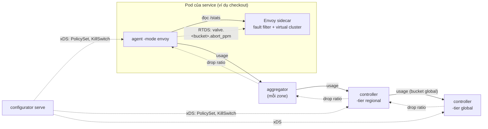

# Triển khai: từ thiết kế đến code

Mọi phần của thiết kế đã có code và đã chạy thử, trừ ba phần: giới hạn theo user/tenant (để sau, theo câu hỏi mở), mô phỏng tác động policy trên traffic lịch sử, và filter Go chạy trong Envoy (hướng 1). Thiết kế đầy đủ ở [design.md](design.md), cách chạy ở [operations.md](operations.md).

## Trạng thái theo phần của thiết kế

| Phần thiết kế | Trạng thái | Code |
| --- | --- | --- |
| Giao thức `RateLimitControl.Sync` | Xong; mở rộng tương thích ngược (window_start, priority, tier, kill switch, scope_offered_rps) | [`api/ratelimit/v1/ratelimit.proto`](../api/ratelimit/v1/ratelimit.proto) |
| Policy YAML, validate, mặc định `shadow` | Xong; nhiều file trong một thư mục được validate như một tập | [`internal/policy`](../internal/policy) |
| Hot path: match, đếm offered load, drop theo ratio | Xong (~17 ns/request, 0 alloc) | [`internal/filter`](../internal/filter/filter.go) |
| TTL chỉ thị, fail-open | Xong ở mọi tầng | `Filter.ExpireStale`, `envoy.DataPlane.ExpireStale`, [`internal/upstream/merge.go`](../internal/upstream/merge.go) |
| EWMA, hysteresis, slew limit, clamp 0,9 | Xong | [`internal/controller/ratio.go`](../internal/controller/ratio.go) |
| Shed theo priority tier | Xong: usage báo theo (bucket, tier), controller shed từ tier thấp lên | `BucketState.StepTiered`, filter theo tier |
| Scope zonal / regional / global | Xong: zonal có chỉ thị riêng cho từng zone, global tính ở tầng global | [`internal/controller/loop.go`](../internal/controller/loop.go) |
| Tầng global, fallback khi mất global | Xong: region dùng limit × tỷ trọng traffic gần nhất, chưa có tỷ trọng thì fail-open | `Loop.fromGlobal` |
| Leader election | Xong: Kubernetes Lease; standby từ chối stream, `/readyz` chỉ 200 ở leader | [`internal/leader`](../internal/leader/leader.go) |
| Sharding bucket theo hash | Xong: `-shard`/`-shards`, phía dưới gộp chỉ thị từ mọi shard | `Loop.Owns`, `upstream.Merger` |
| Aggregator mỗi zone | Xong (stateless) | [`cmd/aggregator`](../cmd/aggregator/main.go), [`internal/hub`](../internal/hub/hub.go) |
| Phân phối cấu hình qua xDS | Xong: ADS (go-control-plane), ACK/NACK, giữ bản hợp lệ gần nhất | [`internal/xds`](../internal/xds), `configurator serve` |
| Kill switch | Xong: kiểu tài nguyên xDS riêng, API admin có token, lưu qua restart | [`cmd/configurator/serve.go`](../cmd/configurator/serve.go) |
| Metric bắt buộc | Xong (Prometheus); xem [operations.md](operations.md#metric) | [`internal/metrics`](../internal/metrics/metrics.go) |
| mTLS giữa các tầng | Xong: TLS 1.3, bắt buộc client cert, tự nạp lại cert khi xoay vòng | [`internal/tlsutil`](../internal/tlsutil/tlsutil.go) |
| Tích hợp Envoy, hướng 2 (stats + RTDS) | Xong, đã chạy với Envoy 1.37 thật | [`internal/envoy`](../internal/envoy), `agent -mode envoy`, `configurator envoy` |
| Tích hợp Envoy, hướng 1 (filter Go trong Envoy) | Chưa | |
| Configurator mô phỏng tác động 7 ngày | Chưa | |
| Heavy-hitter theo user/tenant | Để sau (câu hỏi mở trong thiết kế) | |
| Header `Retry-After` khi trả 429 | Xong: `local_reply_config` của Envoy thêm header cho các 429 do Valve chặn (response flag `FI`), mặc định 1 giây | `envoy.Config`, `configurator envoy -retry-after` |

## Luồng dữ liệu

Mỗi chu kỳ (mặc định 1 giây), usage đi lên và chỉ thị đi xuống trên cùng một stream `Sync` hai chiều. Aggregator và controller dùng chung `hub.Hub` cho phía server; agent, aggregator và controller regional dùng chung `upstream.Run` cho phía client.

## Các quyết định trong code mà thiết kế chưa nói

| Quyết định | Giá trị | Lý do |
| --- | --- | --- |
| Đơn vị usage | Tốc độ: số đếm chia độ dài cửa sổ của chính báo cáo; mỗi node chỉ giữ báo cáo mới nhất | Báo cáo đến lệch chu kỳ hay bị mất không làm R dao động |
| Bucket ID | FNV-32a của `name` | Ổn định giữa các phiên bản và các tầng mà không cần registry; trùng hash bị từ chối |
| Tên bucket | Chỉ `[A-Za-z0-9_-]`, tối đa 100 ký tự | Tên thành stat và runtime key của Envoy |
| Phiên bản config | Hash nội dung của PolicySet | Cùng policy luôn cùng phiên bản trên mọi host; so sánh được qua `valve_config_info` |
| Thứ tự match | caller+endpoint → caller → endpoint → chỉ callee | Bucket cụ thể nhất thắng; hai bucket cùng `match` bị từ chối |
| Priority của request | Request mang tier; không có thì dùng `priority` của bucket | `priority` trong policy là tier mặc định của traffic thuộc bucket |
| Phân bổ shed theo tier | Ratio tổng giữ mọi chốt ổn định (EWMA, hysteresis, slew, clamp); chỉ phần chia giữa các tier theo thứ tự priority | Tier thấp có thể bị drop 100% trong khi ratio tổng vẫn ≤ 0,9 |
| Fallback khi mất global | Bắt đầu từ ratio global cuối cùng, không từ 0 | Thử nghiệm: bắt đầu từ 0 để lọt thêm ~1.300 RPS trong vài giây |
| Leader election | Lease riêng cho mỗi (tầng, shard): `valve-controller-<tier>-<shard>` | Mỗi shard có leader riêng |
| Chỉ leader báo lên global | Standby không gửi usage | Standby gửi số 0 cùng node id sẽ ghi đè số của leader |
| Gộp chỉ thị từ nhiều shard | Mỗi nguồn chỉ được tính trong TTL của chính nó | Một shard im lặng không được các shard khác "làm mới" ratio cũ |
| Kill switch | Hai nguồn OR với nhau: xDS (trực tiếp tới agent) và cờ trong chỉ thị | Vẫn tới được agent khi controller chết |
| Envoy: ratio | Gửi dạng FractionalPercent `{numerator, denominator: MILLION}` | Envoy hiểu số nguyên trơn là phần trăm trên 100, và lớn hơn 100 là luôn abort |
| Envoy: offered load | allowed / (1 − p) với p là ratio Envoy áp trong cửa sổ | Envoy chỉ đếm request tới router; p ≤ 0,9 nên ước lượng bị chặn |
| Envoy: bucket chồng lấn | Bucket rộng loại trừ bucket hẹp bằng một matcher đảo nếu chỉ khác một chiều; khác hai chiều thì cảnh báo | Envoy không biểu diễn được "không phải (A và B)" |
| TTL chỉ thị | 5 giây (`-ttl`) | Lớn hơn vài chu kỳ để chịu được một lần reconnect |
| `Retry-After` | 1 giây, cố định | Bằng một chu kỳ điều khiển; sau đó drop ratio có thể đã đổi. Fault filter không thêm được header nên dùng `local_reply_config` |

## Kết quả đo được

| Phép đo | Kết quả | So với yêu cầu |
| --- | --- | --- |
| `BenchmarkDecide`, song song, Apple Silicon | ~17 ns/op, 0 alloc | p99 < 100 µs |
| In-process: 30k RPS vào limit 20k | Bắt đầu drop sau ~2–3 giây, ổn định ~20k sau ~5 giây | 1–3 giây đến lúc bắt đầu drop |
| Hai region, mỗi bên 15k RPS, limit global 20k | Mỗi region ~10k allowed | Quota toàn cục |
| Giết controller global | Mỗi region giữ ~10k (fallback theo tỷ trọng), không có đỉnh lọt qua | Giữ phần nào bảo vệ khi mất global |
| Giết controller hoặc aggregator | Agent fail-open khi TTL 5 giây hết | Fail-open |
| Đổi limit trong Git | Áp dụng trong ~1–2 giây, hội tụ sau ~5 giây | Rollback trong vài giây |
| Policy lỗi | Bị từ chối, bản cũ vẫn chạy | Giữ bản hợp lệ gần nhất |
| Kill switch qua API | Có hiệu lực sau ~1 giây | Dưới 10 giây |
| Envoy thật, 300 RPS vào limit 200 | Trung bình 195 RPS được qua trong 30 giây (−2,5%) | Sai số ±5–10% |

Các số đo bằng `make bench`, chạy các binary trên một máy, và `make demo-up` với Envoy 1.37. Chưa phải load test ở quy mô thật.

## Hạn chế đã biết

- Ở chế độ Envoy, mọi traffic của một bucket dùng chung một ratio: Envoy không phân biệt tier.
- Ở chế độ Envoy, khi đổi bucket (thêm, xoá, đổi match) phải sinh lại cấu hình Envoy bằng `configurator envoy` và triển khai lại sidecar. Agent chỉ điều khiển ratio của các bucket đã có trong cấu hình Envoy.
- Header caller (`x-valve-caller`) chỉ an toàn khi do gateway hoặc mesh đặt. Trong mesh có mTLS, dùng `-caller-spiffe`.
- Kênh RTDS giữa agent và Envoy là plaintext trên loopback của pod.
- Cert CA (`-tls-ca`) chỉ được đọc lúc khởi động; cert và key thì tự nạp lại.
