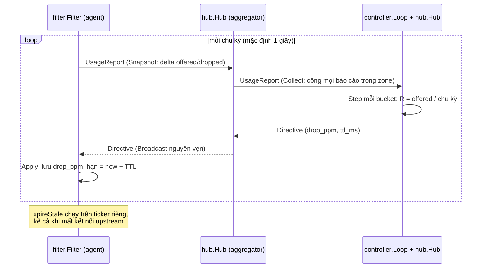

# Triển khai: từ thiết kế đến code

Code hiện có chạy được trọn vòng phản hồi controller ← aggregator ← agent trên một máy, với filter in-process và load giả lập. Chưa có tích hợp Envoy, xDS, tầng global, leader election và metric. Thiết kế đầy đủ ở [design.md](design.md).

## Trạng thái theo phần của thiết kế

| Phần thiết kế | Trạng thái | Code |
| --- | --- | --- |
| Giao thức `RateLimitControl.Sync` | Xong, đúng schema trong thiết kế | [`api/ratelimit/v1/ratelimit.proto`](../api/ratelimit/v1/ratelimit.proto), sinh ra [`gen/`](../gen) |
| Policy YAML, validate, mặc định `shadow` | Xong | [`internal/policy/policy.go`](../internal/policy/policy.go) |
| Bảng match biên dịch sẵn | Xong | [`internal/policy/table.go`](../internal/policy/table.go) |
| Hot path: đếm offered load, drop theo ratio, 429 | Xong | [`internal/filter/filter.go`](../internal/filter/filter.go) |
| Counter chia shard | Xong | [`internal/counter/counter.go`](../internal/counter/counter.go) |
| Shadow mode, kill switch (trong filter) | Xong; kênh phân phối kill switch chưa có | `Filter.SetKillSwitch` |
| TTL chỉ thị, fail-open | Xong, đã thử khi mất controller và mất aggregator | `Filter.ExpireStale`, [`internal/upstream`](../internal/upstream/upstream.go) |
| EWMA, hysteresis, slew limit, clamp 0,9 | Xong | [`internal/controller/ratio.go`](../internal/controller/ratio.go) |
| Phân bổ shed theo priority tier | Có hàm `AllocateByPriority`, chưa nối vào filter/controller | `internal/controller/ratio.go` |
| Aggregator mỗi zone | Xong (stateless, relay chỉ thị) | [`cmd/aggregator`](../cmd/aggregator/main.go), [`internal/hub`](../internal/hub/hub.go) |
| Controller regional | Xong một instance, chưa leader election | [`cmd/controller`](../cmd/controller/main.go), [`internal/controller/loop.go`](../internal/controller/loop.go) |
| Bỏ qua số liệu quá hạn | Xong: báo cáo cũ hơn 3 chu kỳ bị bỏ | `hub.New(staleAfter)` |
| Configurator: validate | Xong (`configurator validate`) | [`cmd/configurator`](../cmd/configurator/main.go) |
| Configurator: mô phỏng 7 ngày, đẩy xDS | Chưa | |
| Tầng global, scope `global`/`zonal` khác nhau | Chưa: mọi bucket đang tính trên usage controller nhận được | |
| Leader election, sharding bucket theo hash | Chưa | |
| Tích hợp Envoy (hướng 2: stats + RTDS) | Chưa: agent đang dùng filter in-process + load giả lập | [`cmd/agent`](../cmd/agent/main.go) |
| Heavy-hitter theo user/tenant | Chưa (câu hỏi mở) | |
| Metric OpenTelemetry/Prometheus | Chưa | |
| mTLS giữa các tầng, caller từ mTLS identity | Chưa: kết nối đang `insecure` | |

## Luồng dữ liệu trong code

Aggregator và controller dùng chung `hub.Hub` làm phía server; agent và aggregator dùng chung `upstream.Run` làm phía client. Đây là cách hiện thực ý "cùng hình dạng ở mọi tầng" của thiết kế.

## Các quyết định trong code mà thiết kế chưa nói

| Quyết định | Giá trị hiện tại | Lý do |
| --- | --- | --- |
| Bucket ID | FNV-32a của `name` | Ổn định giữa các phiên bản config và giữa các tầng mà không cần registry; trùng hash bị validate từ chối |
| Thứ tự ưu tiên khi match | caller+endpoint → caller → endpoint → chỉ callee | Bucket cụ thể nhất thắng; hai bucket cùng `match` bị từ chối |
| `callee` | Bắt buộc | Bucket luôn bảo vệ một callee |
| Hysteresis | Bật khi R̂ > L·(1+5%); đã bật thì giữ công thức thường, tự về 0 khi R̂ ≤ L | Tránh bật/tắt quanh ngưỡng mà không giữ drop khi đã hết quá tải |
| TTL chỉ thị | 5 giây (`-ttl` ở controller) | Lớn hơn vài chu kỳ để chịu được một lần reconnect |
| Peer chậm | Chỉ nhận chỉ thị mới nhất, chỉ thị cũ chưa gửi bị thay | Không dồn hàng đợi chỉ thị lỗi thời |
| Peer mới kết nối | Nhận ngay chỉ thị cuối cùng | Không phải chờ hết một chu kỳ |
| Drop ratio trên dây | `drop_ppm` (phần triệu), filter kẹp tối đa 1.000.000 | Số nguyên trên hot path, như thiết kế |
| Tên message protobuf | Giữ đúng thiết kế, tắt 3 luật đặt tên của `buf lint` | Xem `buf.yaml` |

## Kết quả đo được

| Phép đo | Kết quả | So với yêu cầu |
| --- | --- | --- |
| `BenchmarkDecide` (song song, Apple Silicon) | ~18 ns/op, 0 alloc | Ngân sách p99 < 100 µs |
| Phản ứng spike: 30k RPS vào bucket limit 20k | Bắt đầu drop sau ~2–3 giây, ổn định ~20k allowed / ~10k rejected sau ~5 giây | Yêu cầu 1–3 giây đến lúc bắt đầu drop |
| Giết controller | Agent fail-open khi TTL 5 giây hết hạn | Fail-open khi mất control plane |
| Giết aggregator | Agent fail-open khi TTL hết hạn, tiếp tục thử kết nối lại | Như trên |

Các số trên đo bằng `make bench` và `make run-local` trên một máy, chưa phải load test thật.

## Hạn chế đã biết

- Controller tính R = tổng offered nhận được trong chu kỳ / độ dài chu kỳ. Báo cáo đến lệch chu kỳ hoặc bị mất sẽ làm R dao động; cần gắn usage theo `window_end_unix_ms` thay vì theo thời điểm nhận.
- `hub` và `upstream` chưa có test riêng; mới kiểm tra qua chạy thử toàn hệ thống.
- Load giả lập trong agent chỉ đánh vào bucket đầu tiên của file policy.
